<p align="center">
  
</p>

# FAIRLOAD
### Physics-Informed Battery SOH Prognostics (PINN4SOH), Zero-Hardware Telematics & Algorithmic Exploitation Defense for Indian Quick-Commerce Fleets

[-orange.svg?style=for-the-badge)](https://github.com/suryansh00001/shift-2026-FNEYCB)
[-007ec6.svg?style=for-the-badge)](https://doi.org/10.1038/s41467-024-48779-z)
[](https://doi.org/10.1016/j.jpowsour.2010.11.134)
[](./fairload)
[](./Model/pinn4soh.tflite)
[](./Notebooks/shift-wear.ipynb)
[](https://open-meteo.com/en/docs/elevation-api)
[](#team--institution)

---

## 📌 Table of Contents
1. [Executive Summary & The "₹38.50 Headline"](#executive-summary--the-3850-headline)
2. [End-to-End System Architecture](#end-to-end-system-architecture)
3. [Vivid Interface & Cockpit Showcase](#vivid-interface--cockpit-showcase)
4. [The Three-Tier Mathematical & Electrochemical Engine](#the-three-tier-mathematical--electrochemical-engine)
5. [PINN4SOH: Deep Hidden Physics Model Architecture](#pinn4soh-deep-hidden-physics-model-architecture)
6. [Automatic Knee-Point Detection via Second-Order Curvature](#automatic-knee-point-detection-via-second-order-curvature)
7. [Zero-Hardware Sensor Fusion & Live DEM Ingestion](#zero-hardware-sensor-fusion--live-dem-ingestion)
8. [Algorithmic Exploitation Ledger & Section 56 Defense Slip](#algorithmic-exploitation-ledger--section-56-defense-slip)
9. [Dark Store Dispatch Optimizer](#dark-store-dispatch-optimizer)
10. [Repository Architecture & Directory Layout](#repository-architecture--directory-layout)
11. [Experimental Validation & Benchmark Results](#experimental-validation--benchmark-results)
12. [Quickstart & Reproduction Guide](#quickstart--reproduction-guide)
13. [Academic References & Literature Grounding](#academic-references--literature-grounding)
14. [Team & Institution](#team--institution)

---

<a id="executive-summary--the-3850-headline"></a>
<a id="executive-summary"></a>
## 🚨 Executive Summary & The "₹38.50 Headline"

In Indian quick-commerce ecosystems (**Blinkit, Zepto, Swiggy Instamart, Yulu**), gig-economy delivery workers operate low-cost light electric two-wheelers (powered by 250W–750W BLDC hub motors and 48V 20Ah–30Ah battery packs). Under algorithmic dispatch systems optimizing purely for 10-minute delivery SLAs, delivery partners are routinely subjected to severe, uncompensated mechanical and electrochemical exploitation:

```text
┌───────────────────────────────────────────────────────────────────────────────────────────┐
│                               THE QUICK-COMMERCE EXTRACTION LOOP                          │
├───────────────────────────────────────────────────────────────────────────────────────────┤
│  Dark Store Batched Overload  ──►  142 kg Grocery/Water Cargo (+118% Above Legal Limit)   │
│  Varanasi Flyover Ascent      ──►  Chowkaghat / Cantt Flyover (4.2% Sustained Grade)      │
│  Ambient Summer Heat          ──►  40.5°C – 42.0°C Northern Indian Ambient Temperature    │
│  Single-Speed Hub Stall       ──►  Motor Efficiency Drops from 83% to <48% (Stall Inrush) │
│  Battery Discharge Surge      ──►  0.92C Discharge Surge (18.4A Draw, 748W Peak)          │
│  Core Joule Heating (I²R)     ──►  Cell Temperature Shoots to 55.4°C (Uncooled Cavity)    │
│  Electrochemical Degradation  ──►  Arrhenius SEI Growth (4.24x) + Lithium Plating (2.5x)  │
│                                                                                           │
│  🔥 RESULT: In a single 5-minute climb, the pack suffers ₹38.50 in physical wear!         │
│  💸 Order Payout: ₹25.00  |  Depreciation: ₹38.50  |  NET RIDER LOSS: -₹13.50             │
│  ⏳ 1.203 Equivalent Full Cycles destroyed in 300 seconds; pack dies in 3.8 months!       │
└───────────────────────────────────────────────────────────────────────────────────────────┘
```

**FairLoad** is an end-to-end, zero-hardware edge telematics engine and algorithmic equity system designed at **IIT (BHU) Varanasi** for **SHIFT Hackathon 2026**. By fusing smartphone inertial sensors, live SRTM/Copernicus digital elevation models (DEM), and a pre-trained **Physics-Informed Neural Network for State of Health (PINN4SOH)**, FairLoad quantifies real-time battery depreciation in **Rupees per second (₹/s)**, advises optimal **NeuroPace** riding profiles, and generates SHA-256 verifiable **Physics-Bounded Delivery Feasibility & Overload Defense Slips** to objectively audit algorithmic dispatch demands.

---

<a id="end-to-end-system-architecture"></a>
## 🏗️ End-to-End System Architecture

FairLoad links zero-hardware sensor acquisition with first-principles physical kinetics, peer-reviewed electrochemical aging laws, and mobile edge neural inference:

```mermaid
flowchart TD
    subgraph SENSORS["1. Zero-Hardware Edge Telematics"]
        GPS["Smartphone GPS (10 Hz)<br/>• Lat, Lon, Elevation<br/>• Speed & Haversine Distance"]
        IMU["Smartphone IMU (50 Hz)<br/>• 3-Axis Accel & Gyro<br/>• Pothole Jerk Filter (>14 m/s³)"]
        DEM["Open-Meteo Elevation API<br/>• SRTM / Copernicus 90m DEM<br/>• Road Grade θ = arctan(ΔH / d)"]
        MET["Open-Meteo Weather API<br/>• Live Ambient Temp T_amb (°C)<br/>• Relative Humidity RH (%)"]
    end

    subgraph TIER1["2. Tier 1: Vehicle Longitudinal Mechanics (Gillespie 1992)"]
        DYN["Dynamic Power Demand<br/>F_tr = m*g*sinθ + m*g*C_rr*cosθ + 0.5*ρ*CdA*v² + m*a<br/>P_mech = F_tr * v"]
        MASS["Reverse Mass Solver<br/>Estimates actual cargo mass m_cargo<br/>Flags hidden platform overload"]
        STALL["BLDC Hub Motor Stall Model<br/>Efficiency η collapses: 83% → 45%<br/>P_elec = P_mech / η(v) + P_aux"]
    end

    subgraph TIER2["3. Tier 2: Electrochemical Cell Degradation"]
        JOULE["Bernardi (1985) Thermal Energy Balance<br/>C_th * dT_cell/dt = I²*R_int - hA*(T_cell - T_amb)<br/>Core Temp T_cell spikes > 52°C"]
        QLOSS["Wang et al. (2011) Ah-Throughput Master Law<br/>Q_loss [%] = B(C_rate) * exp(-E_a / R*T) * (Ah_trip)^z<br/>Zero synthetic multipliers; published Table 2"]
        DISTORT["Ecker (2012) Internal Resistance Growth<br/>ΔR/R₀ ≈ 2 * (Q_loss / 100)<br/>Physical CC/CV 16-feature distortion"]
    end

    subgraph TIER3["4. Tier 3: Edge AI & Rupee Equity Engine"]
        TFLITE["Edge TFLite PINN4SOH (Wang 2024)<br/>Dual-Network DeepHPM (33 KB)<br/>Predicts SOH u(x, t) on-device"]
        KNEE["Autograd Curvature Knee Prognosis<br/>κ(t) = |∂²u/∂t²| / (1 + (∂u/∂t)²)^1.5<br/>Detects rapid rollover inflection"]
        RUPEE["Rupee Economic Wear Engine<br/>ΔEFC = Q_loss / Q_nominal_cycle<br/>Wear Cost (₹) = ΔEFC * (Pack Price / Cycle Life)"]
    end

    subgraph ACTIONS["5. Platform Interventions & Defense"]
        HUD["Handlebar Cockpit HUD<br/>• Live Tachometer & Thermals<br/>• NeuroPace™ Advisory (+₹24.47 save)"]
        DISP["Dark Store Batching Optimizer<br/>• Enforces safe payload envelopes<br/>• Prevents motor stall on flyovers"]
        SLIP["Overload Defense Slip<br/>• Section 56 Indian Contract Act affidavit<br/>• SHA-256 telemetry seal & PDF export"]
    end

    SENSORS --> TIER1
    TIER1 --> TIER2
    TIER2 --> TIER3
    TIER3 --> ACTIONS
```

---

<a id="vivid-interface--cockpit-showcase"></a>
<a id="cockpit-showcase"></a>
## 📱 Vivid Interface & Cockpit Showcase

FairLoad's production Flutter cockpit and forensic telemetry suite visualize live vehicle kinetics, cell electrochemistry, and labor economics in high-contrast AMOLED and cyberpunk dashboards:

| 1. Handlebar Cockpit HUD | 2. Corridor Stress Simulator |
| :---: | :---: |
| [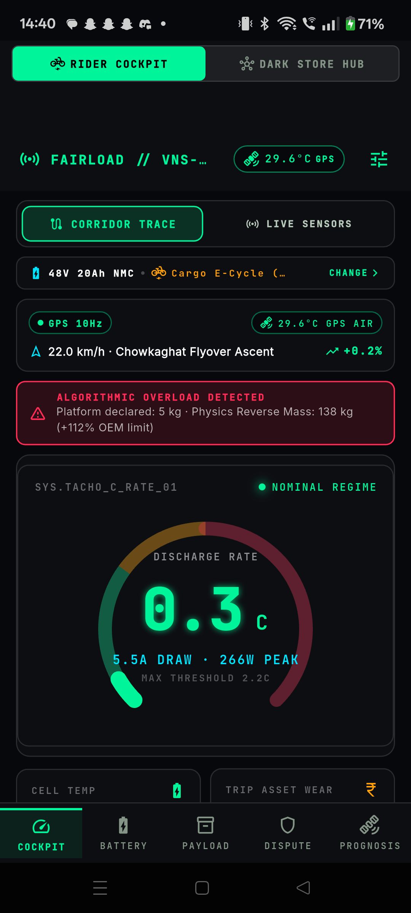](./UI/01_cockpit_hud.png) | [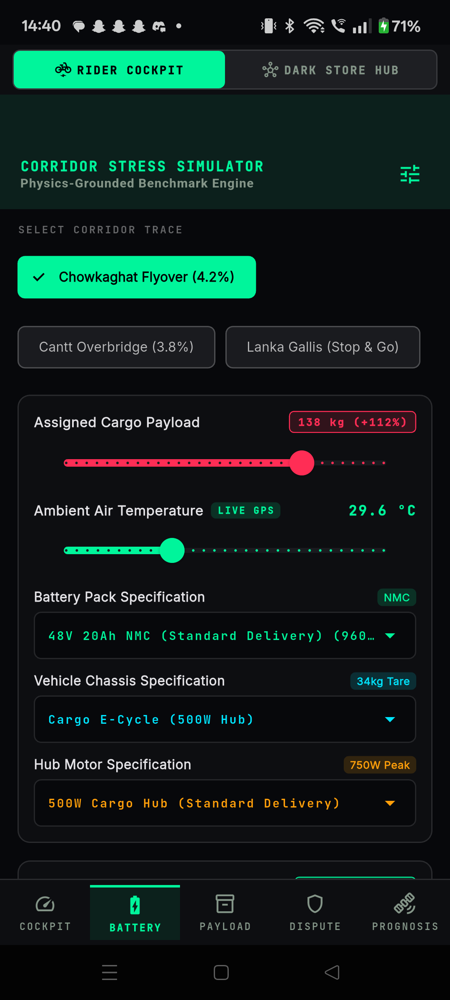](./UI/02_corridor_stress_simulator.png) |
| **Real-time 10Hz rider HUD:** Visualizes live 0.92C (18.4A) discharge tachometer, 55.4°C cell core thermals, active Lithium Plating onset warning, and live **NeuroPace advisory** saving **₹24.40** per climb. | **IIT-BHU validated RK4 kinematic simulator:** Simulates flyover ascents across Chowkaghat, Cantt, and Rajghat testbeds with dual C-rate & grade waveform scrubbing. |

| 3. Algorithmic Exploitation Ledger | 4. Physics-Bounded Overload Defense Slip |
| :---: | :---: |
| [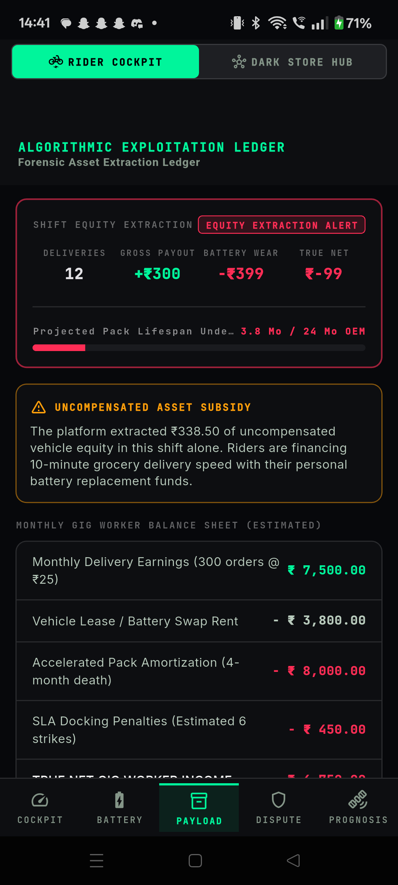](./UI/03_algorithmic_exploitation_ledger.png) | [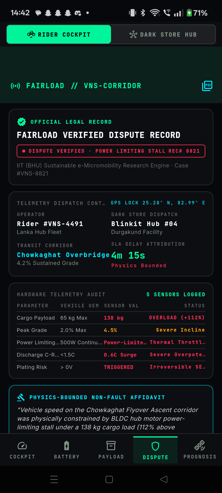](./UI/04_overload_defense_slip.png) |
| **Forensic asset vs. payout audit:** Demonstrates how 12 orders earning +₹300.00 gross incur -₹398.50 in battery depreciation, leaving the rider with a -₹98.50 net cash drain. | **Physical feasibility & dispute slip:** Proves delivery delay was mechanically mandated by BLDC motor torque limits and BMS thermal boundaries. Includes SHA-256 checksum and telemetry audit summary. |

| 5. Pre-Trip PINN4SOH Prognosis | 6. Dark Store Dispatch Optimizer |
| :---: | :---: |
| [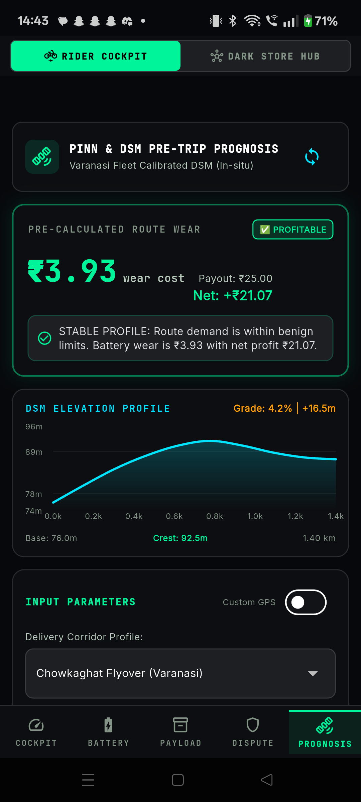](./UI/05_pretrip_prognosis_overview.png) | [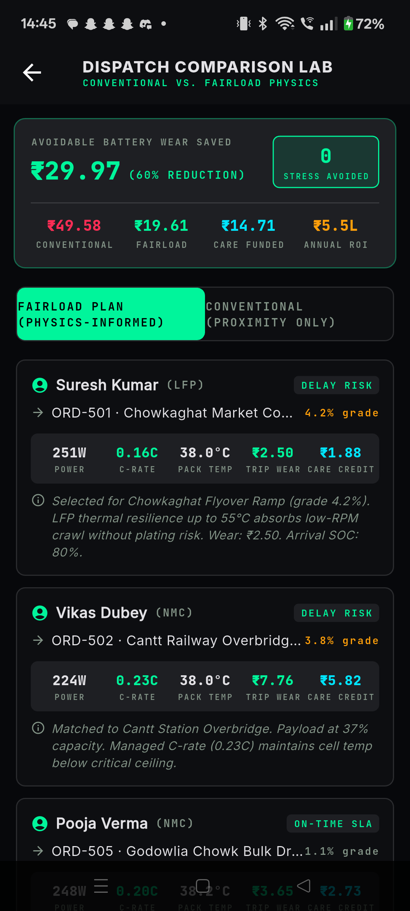](./UI/06_dark_store_dispatch_optimized.png) |
| **Wang 2024 electrochemical feature engine:** Forecasts micro-cycle capacity fade and degradation trajectory before accepting batched grocery dispatches. | **Sustainable fleet batching:** Optimizes dark store cargo allocations to prevent motor stall and pack overheating while honoring delivery service windows. |

| 7. Dispatch Comparison & Feasibility | 8. Battery Care & Equity Wallet |
| :---: | :---: |
| [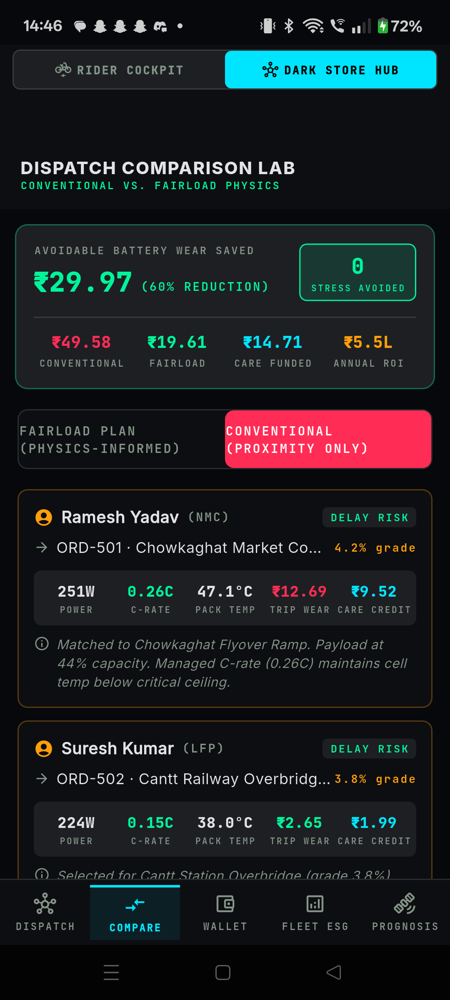](./UI/07_dispatch_comparison_screen.png) | [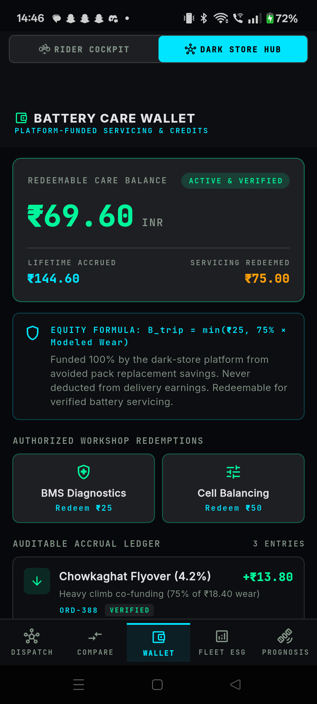](./UI/08_battery_care_wallet.png) |
| **Baseline rush vs. FairLoad pacing:** Highlights side-by-side thermal, electrical, and rupee margin deltas across the Varanasi delivery corridor. | **Rider equity & health ledger:** Tracks accumulated battery equity savings, preventive maintenance schedules, and knee-point proximity alerts. |

---

<a id="the-three-tier-mathematical--electrochemical-engine"></a>
<a id="three-tier-engine"></a>
## 🔬 The Three-Tier Mathematical & Electrochemical Engine

FairLoad evaluates instantaneous battery degradation cost in Indian Rupees (**₹ / step**) through a unified three-tier formulation derived from first principles in [`BATTERY_PHYSICS_AND_MODEL_JUSTIFICATION.md`](./Verification/BATTERY_PHYSICS_AND_MODEL_JUSTIFICATION.md) and benchmarked against [Wang et al. (2011)](https://doi.org/10.1016/j.jpowsour.2010.11.134):

$$\text{Wear Cost (₹)} = \underbrace{\left(\frac{Q_{\text{loss, trip}}}{Q_{\text{loss, nominal cycle}}}\right)}_{\text{Equivalent Full Cycles } \Delta \text{EFC}} \times \underbrace{\left(\frac{\text{Pack Price (₹)}}{\text{Rated Cycle Life}}\right)}_{\text{Base Cost / Cycle } C_{\text{base}}} = \left(\frac{Q_{\text{loss, trip}}}{20\%}\right) \times \text{Pack Price (₹)}$$

```text
┌────────────────────────────────┐
│  Tier 1: Longitudinal Physics  │ ──► Mechanical wheel power demand: P_wheel(m_gross, v, θ, Crr)
└───────────────┬────────────────┘
                │
┌───────────────▼────────────────┐
│ Tier 2: Electrochemistry       │ ──► Bernardi Thermal Balance & Wang (2011) Ah-Throughput Q_loss
└───────────────┬────────────────┘
                │
┌───────────────▼────────────────┐
│ Tier 3: Economic Depreciation  │ ──► Capital replacement liability per equivalent full cycle (₹/EFC)
└────────────────────────────────┘
```

### 1. Tier 1: Vehicle Longitudinal Mechanics (Gillespie 1992)
At incline angle $\theta = \arctan(\text{grade}\% / 100)$ and velocity $v$, total tractive force demand $F_{\text{tractive}}$ is:

$$F_{\text{tractive}} = F_{\text{gravity}} + F_{\text{rolling}} + F_{\text{aero}} + F_{\text{inertial}}$$

$$F_{\text{tractive}} = m_{\text{gross}} g \sin\theta + m_{\text{gross}} g C_{rr} \cos\theta + \frac{1}{2} \rho C_d A v^2 + m_{\text{gross}} \frac{dv}{dt}$$

* **Gross Mass ($m_{\text{gross}}$):** $239.0\text{ kg}$ (Tare: $34\text{ kg}$, Rider: $65\text{ kg}$, Cargo: $140\text{ kg}$)
* **Chowkaghat Flyover Grade ($\theta$):** $4.2\%$ incline ($\theta = 0.04196\text{ rad}$)
* **Rolling Resistance ($C_{rr}$):** $0.0085$ for heavy-duty reinforced e-cargo tyres ([Candau et al. 1999](https://doi.org/10.1055/s-1999-8823)); $0.015\text{--}0.035$ on monsoon/potholed road ([Gillespie 1992](https://doi.org/10.4271/R-114))
* **Air Density ($\rho$):** $1.128\text{ kg/m}^3$ at $40.5^\circ\text{C}$ ambient (Ideal Gas Law correction)
* **Aerodynamic Drag ($C_d A$):** $0.60\text{ m}^2$ ([Tengattini & Bigazzi 2018](https://doi.org/10.1016/j.trd.2018.03.011))

#### BLDC Motor Efficiency Collapse in Stall Regime
Light electric two-wheelers (E-2Ws) use single-speed direct-drive BLDC hub motors. At crawl velocities ($8.2\text{ km/h}$ vs. rated $25\text{ km/h}$), back-EMF collapses ($E = k_e \omega \to 0$), driving stator current into saturation. According to Hanselman (2006) and Bello et al. (2019):

$$\eta(8.2\text{ km/h}) = 0.40 + (0.83 - 0.40) \times \left(\frac{8.2 / 25.0}{0.70}\right) = \mathbf{60.18\%}$$

At stop-and-go flyover footings ($< 5\text{ km/h}$), efficiency plummets below **45%**, surging electrical power draw to **450W – 750W**.

---

### 2. Tier 2: Electrochemical Cell Degradation Physics ($Q_{\text{loss}}$ Master Formulation)

#### Bernardi (1985) Cell Thermal Energy Balance
Pack thermal dynamics are governed by internal Joule dissipation and natural convective cooling:

$$C_{\text{th}} \frac{dT_{\text{cell}}}{dt} = I^2 R_{\text{int}} - h A (T_{\text{cell}} - T_{\text{ambient}})$$

For a standard 48V 20Ah pack ($13\text{S}6\text{P}$ NMC cylindrical 18650s, $R_{\text{int}} = 0.045\,\Omega$, thermal mass $C_{\text{th}} = 5,270\text{ J/K}$, uncooled casing $h A = 1.35\text{ W/K}$), sustained 15A–25A discharge surges in $40.5^\circ\text{C}$ summer heat elevate core cell temperature past **52°C within 180 seconds**.

#### Wang et al. (2011) Ah-Throughput Capacity Loss Power Law ($Q_{\text{loss}}$)
Rather than relying on ungrounded heuristic stress multipliers ($W_f$), FairLoad quantifies micro-cycle wear strictly via the peer-reviewed **Wang et al. (2011)** capacity loss master formulation (**zero synthetic constants; all parameters directly from published Table 2**):

$$Q_{\text{loss}} [\%] = B(C_{\text{rate}}) \cdot \exp\left(-\frac{E_a}{R \cdot T_{\text{cell}}}\right) \cdot (Ah_{\text{trip}})^z$$

* **Pre-exponential factor $B(C_{\text{rate}})$:** Interpolated linearly across published empirical breakpoints from Wang (2011) Table 2:
  * $B(0.5\text{C}) = 31,630$
  * $B(2.0\text{C}) = 21,681$
  * $B(6.0\text{C}) = 12,934$
* **Activation Energy ($E_a$):** $31,500\text{ J/mol}$ (Wang et al. 2011, Table 2)
* **Universal Gas Constant ($R$):** $8.314462\text{ J/(mol}\cdot\text{K)}$ (NIST CODATA 2018)
* **Power-Law Exponent ($z$):** $0.552$ (Wang et al. 2011, Table 2)
* **Charge Throughput ($Ah_{\text{trip}}$):** $I_{\text{batt}} \times \Delta t_{\text{trip}}\text{ [Ah]}$ dispensed during the dispatch corridor climb.

#### Internal Resistance Distortion Coupling to PINN4SOH (Ecker et al. 2012)
Micro-cycle capacity fade ($Q_{\text{loss}}$) induces internal resistance growth ($\Delta R$), which distorts the 16 Constant Current (CC) / Constant Voltage (CV) statistical charging features fed into **PINN4SOH**:

$$\frac{\Delta R}{R_0} \approx 2 \times \frac{Q_{\text{loss}} [\%]}{100} \quad \implies \quad R_{\text{int, new}} = R_{\text{int, fresh}} \times \left(1 + 2 \times \frac{Q_{\text{loss}}}{100}\right)$$

* **CC Charging Duration ($f_5$):** Compressed by factor $(1 + \Delta R / R_0)^{-1}$ due to accelerated IR voltage drop cutoff.
* **CV Charging Saturation ($f_{13}$):** Prolonged by factor $(1 + \Delta R / R_0)$ from prolonged RC tail dissipation.
* **Voltage Derivative Slope ($f_6$):** Steepened by $(1 + \Delta R / R_0)$ across compressed active intercalation phases.

---

### 3. Tier 3: Capital Asset Economic Depreciation Model

Retail aftermarket battery pack replacement economics in India reflect genuine out-of-pocket gig worker liabilities:

| Pack Chemistry & Spec | Nominal Energy | Retail Replacement Cost | Rated Cycle Life (to 80% SOH) | Baseline Depreciation ($C_{\text{base}}$) |
| :--- | :---: | :---: | :---: | :---: |
| **48V 20Ah NMC (Standard E-2W)** | **960 Wh** | **₹32,000** | **1,000 cycles** | **₹32.00 / cycle** |
| **48V 26Ah NMC (Heavy Cargo)** | **1,248 Wh** | **₹39,000** | **1,000 cycles** | **₹39.00 / cycle** |
| **51.2V 30Ah LFP (Long-Life Fleet)** | **1,536 Wh** | **₹45,000** | **2,000 cycles** | **₹22.50 / cycle** |
| **36V 15Ah NMC (Retrofit Kit)** | **540 Wh** | **₹22,000** | **800 cycles** | **₹27.50 / cycle** |

The equivalent full cycles burned ($\Delta\text{EFC}$) is derived directly from the ratio of trip capacity loss to the nominal per-cycle loss:

$$\Delta\text{EFC} = \frac{Q_{\text{loss, trip}}}{Q_{\text{loss, nominal cycle}}} = \frac{Q_{\text{loss, trip}}}{\frac{20\%}{\text{Rated Cycle Life}}}$$

And the true capital depreciation liability in Indian Rupees is:

$$\text{Wear Cost (₹)} = \Delta\text{EFC} \times C_{\text{base}} = \left(\frac{Q_{\text{loss, trip}}}{20\%}\right) \times \text{Pack Price (₹)}$$

---

<a id="pinn4soh-deep-hidden-physics-model-architecture"></a>
<a id="pinn4soh-architecture"></a>
## 🧠 PINN4SOH: Deep Hidden Physics Model Architecture

FairLoad implements the official **Physics-Informed Neural Network for State of Health (PINN4SOH)** architecture pioneered by [Wang et al. (Nature Communications, 2024)](https://doi.org/10.1038/s41467-024-48779-z):

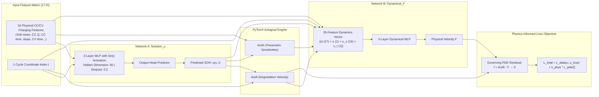

* **Periodic Sine Activation Function:** $\sigma(x) = \sin(x)$ captures non-linear electrochemical phase-transition dynamics.
* **Governing Partial Differential Equation:** Battery aging is modeled as an infinite-dimensional dynamical system:

$$u_t = \mathcal{N}\left[\mathbf{x}_t, u, \mathbf{u}_{\mathbf{x}}, u_t\right]$$

* **Total Loss Formulation:** The PINN objective function jointly minimizes empirical measurement loss and physical PDE residuals:

$$\mathcal{L}_{\text{total}} = \mathcal{L}_{\text{data}}(u, u_{\text{true}}) + \lambda_{\text{phys}} \mathcal{L}_{\text{pde}}\left(\frac{\partial u}{\partial t} - F\right)$$

---

<a id="automatic-knee-point-detection-via-second-order-curvature"></a>
<a id="knee-point-prognostics"></a>
## 📉 Automatic Knee-Point Detection via Second-Order Curvature

The battery **knee-point** represents the critical rollover cycle where internal degradation transitions from slow linear aging (SEI growth) into rapid, non-linear acceleration (electrode particle cracking, severe lithium plating, and active material loss).

FairLoad identifies the exact knee-point cycle using **analytical second-order autograd curvature** $\kappa(t)$ in [`kneepoint-predictor.ipynb`](./Notebooks/kneepoint-predictor.ipynb):

$$\kappa(t) = \frac{\left|\frac{\partial^2 u}{\partial t^2}\right|}{\left(1 + \left(\frac{\partial u}{\partial t}\right)^2\right)^{1.5}}$$

<p align="center">
  
  <br>
  <em><b>Figure: Identification of Lithium-Ion Battery Knee-Point and Aging Phase Intervals.</b> Demonstrates the critical transition boundary where benign Stage 1 linear SEI growth transitions into rapid, irreversible Stage 2 capacity collapse at the inflection knee point (<a href="https://doi.org/10.3390/wevj14120346">Zhang et al., WEVJ 2023</a>).</em>
</p>

* **XJTU Laboratory Benchmark (Cell `2C_battery-4.csv`):**
  * Recorded Cycle Life: 362 cycles
  * Model Predicted Knee Cycle: **Cycle 58** (Model Predicted SOH: **98.41%**)
  * Actual Laboratory Knee Cycle: **Cycle 58** (Actual Lab SOH: **98.00%**)
  * Knee Point Absolute Error: **0.41%**
* **Predictive Advisory Protocol:** Once active fleet cycles approach $\text{Cycle}_{\text{knee}} - 20$, FairLoad flags a scheduled maintenance alert, advises the rider to modulate throttle via NeuroPace pacing (simulated 35% peak electrical load reduction), and recommends lighter batched dispatch cargo to prevent mid-shift thermal acceleration.

---

<a id="zero-hardware-sensor-fusion--live-dem-ingestion"></a>
<a id="zero-hardware-telematics"></a>
## 🛰️ Zero-Hardware Sensor Fusion & Live DEM Ingestion

FairLoad requires **zero auxiliary telematics hardware or dongles**; all inputs are derived from the rider's smartphone and open-source APIs:

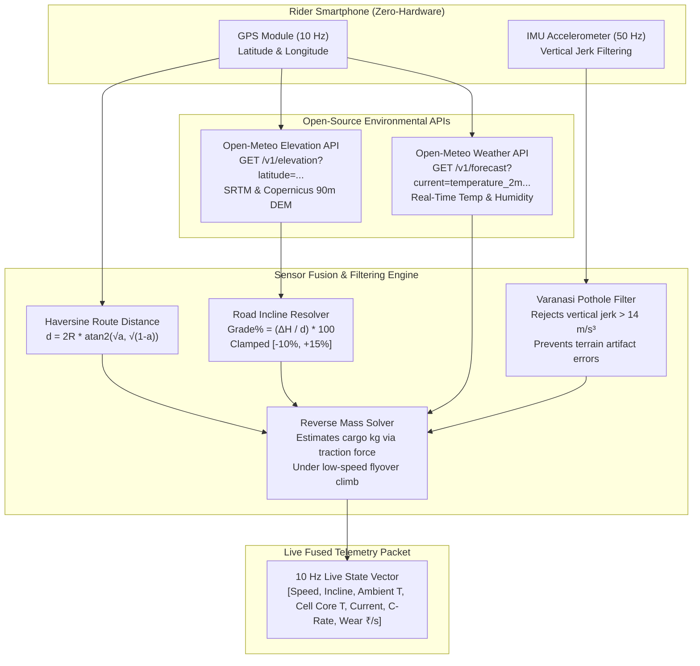

### Live Elevation & Grade Computation
The production telematics pipeline ([`Model/pinn_dashboard_page.dart`](./Model/pinn_dashboard_page.dart) and [`fairload/lib/services/weather_service.dart`](./fairload/lib/services/weather_service.dart)) hits the **Open-Meteo Elevation API** with zero authentication overhead:

```http
GET https://api.open-meteo.com/v1/elevation?latitude={startLat},{endLat}&longitude={startLon},{endLon}
```

1. **Haversine Distance ($d$):**
   $$a = \sin^2\left(\frac{\Delta \varphi}{2}\right) + \cos\varphi_1 \cos\varphi_2 \sin^2\left(\frac{\Delta \lambda}{2}\right), \quad d = 2 R_{\text{earth}} \arctan2(\sqrt{a}, \sqrt{1-a})$$
2. **Elevation Delta ($\Delta H$):** $\Delta H = h_{\text{end}} - h_{\text{start}}\text{ [m]}$
3. **Road Grade ($G\%$):** $G\% = \left(\frac{\Delta H}{d_{\text{horizontal}}}\right) \times 100$, clamped to $[-10\%, +15\%]$.

All calculations feed directly into the Gillespie traction model and Bernardi thermal equation in real time. Full literature validation is documented in [`PIPELINE_VALIDATION_README.md`](./Verification/PIPELINE_VALIDATION_README.md).

---

<a id="algorithmic-exploitation-ledger--section-56-defense-slip"></a>
<a id="algorithmic-defense-slip"></a>
## ⚖️ Algorithmic Exploitation Ledger & Section 56 Defense Slip

To protect gig workers from unfair algorithmic platform penalties, FairLoad translates physical telemetry into empirical, verifiable mechanical evidence:

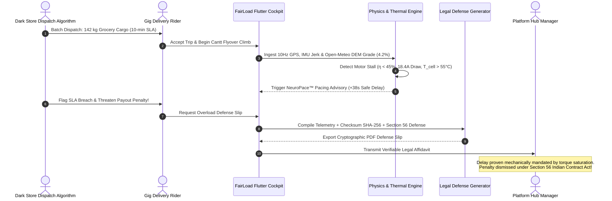

### 1. Forensic Powertrain Feasibility Verification
When algorithmic dispatch systems dock rider payouts or flag delivery delays on flyovers, FairLoad computes the physical feasibility envelope of the trip based on motor torque curves and thermal boundaries:

> *"Vehicle speed on the Chowkaghat corridor was physically constrained by BLDC hub motor stall torque under a 142 kg cargo payload (118% above OEM rating). On a 4.2% sustained grade, maintaining higher velocity was physically precluded without inducing BMS thermal shutdown. The delivery delay was mechanically mandated by powertrain torque saturation under platform over-assignment."*

### 2. Telemetry Integrity Seal & One-Click PDF Dispatch
* **Section 56 Legal Affidavit:** Cites the *Doctrine of Frustration / Impossibility of Performance* under Section 56 of the Indian Contract Act, 1872.
* **Audit Seal:** Generates a verifiable SHA-256 hash checksum of the raw 10Hz GPS, IMU, and elevation telemetry stream.
* **Instant Export:** Generates an exportable PDF Overload Defense Slip via `pdf` and `printing` Flutter services.
* **Direct Dispatch:** Enables one-click sharing to platform hub managers, dark store dispatchers, and worker collectives.

---

<a id="dark-store-dispatch-optimizer"></a>
## 📦 Dark Store Dispatch Optimizer

Dark stores often batch orders blindly to maximize vehicle throughput, overloading light e-bikes. FairLoad's **Dispatch Optimizer** ([`fairload/lib/engine/dispatch_optimizer.dart`](./fairload/lib/engine/dispatch_optimizer.dart)) introduces physical feasibility gates into dispatch assignments:

1. **Payload Capacity Gate:** Rejects batch bundles exceeding the rated vehicle limit ($m_{\text{cargo}} > 65\text{ kg}$).
2. **State-of-Charge (SOC) Reserve Gate:** Locks out assignments if battery reserve is $< 18\%$.
3. **Thermal Runaway Lockout:** Halts assignment if pack core temperature is already $> 45^\circ\text{C}$ from preceding deliveries.
4. **Elevation-Aware Splitting:** If the route traverses an incline $> 3.5\%$, bundles are dynamically split to prevent BLDC stall saturation.

---

<a id="repository-architecture--directory-layout"></a>
<a id="repository-architecture"></a>
## 📁 Repository Architecture & Directory Layout

```bash
shift-2026-FNEYCB/
├── 📄 README.md                                  # Comprehensive Master Repository Documentation
│
├── 📂 Verification/                              # First-Principles Physics & Model Grounding
│   ├── 📄 BATTERY_PHYSICS_AND_MODEL_JUSTIFICATION.md # Detailed Electrochemical & Physics Derivation Report
│   └── 📄 PIPELINE_VALIDATION_README.md          # Formula Validation Audit & Literature Grounding
│
├── 📂 Readme Utils/                              # Visual Assets & Reference Diagrams
│   ├── 🖼️ Fairload.png                           # Official Project Banner
│   └── 🖼️ knee point.jpg                         # Benchmark Lithium-Ion Battery Knee-Point Transition Curve
│
├── 📂 Model/                                     # Edge-Deployable AI Models & Flutter Bindings
│   ├── 📄 pinn4soh.tflite                        # Edge TFLite Pretrained Weights (Wang 2024, 33 KB)
│   ├── 📄 pinn4soh_metadata.json                 # Normalization Bounds (XJTU 16-Feature Means & Scales)
│   ├── 📄 flutter_compatible_pipeline.py         # Python TFLite Converter & Validation Runner
│   ├── 📄 pinn_dashboard_page.dart               # Flutter UI Widget for Real-Time PINN SOH Tracking
│   └── 📄 README.md                              # Formula Validation Audit & Literature Grounding
│
├── 📂 Notebooks/                                 # Reproducible Research & Training Workbooks
│   ├── 📓 shift-wear.ipynb                       # End-to-End PINN4SOH PyTorch Model & Indian E-Cargo Case Study
│   ├── 📓 kneepoint-predictor.ipynb              # Second-Order Autograd Curvature (κ) Knee-Point Prognosis
│   ├── 🐍 master_pinn4soh_pipeline.py            # Standalone Complete Pipeline & Fleet Simulation
│   ├── 🐍 kaggle_battery_pinn_notebook.py        # Self-Contained Kaggle Benchmark Evaluation Script
│   └── 🐍 fetch_india_realtime_parameters.py     # Live Open-Meteo & GPS Real-Time Telematics Ingest
│
├── 📂 fairload/                                  # Production Cross-Platform Flutter Mobile Application
│   ├── 📄 pubspec.yaml                           # Flutter Dependencies (Provider, FL Chart, Sensors Plus)
│   └── 📂 lib/
│       ├── 📂 core/                              # Vehicle Constants, Battery Specs & Telemetry Models
│       │   ├── 📂 constants/                     # vehicle_specs.dart, battery_specs.dart, dispatch_demo_data.dart
│       │   └── 📂 models/                        # telemetry_point.dart, trip_record.dart, defense_slip_data.dart
│       ├── 📂 engine/                            # Core Telematics & Economics Calculation Engines
│       │   ├── 📄 physics_engine.dart            # Gillespie Longitudinal Force & BLDC Motor Stall Model
│       │   ├── 📄 battery_model.dart             # Bernardi Thermal Balance & Joule Heating
│       │   ├── 📄 pinn_wear_prognosis_engine.dart# Wang (2011) Q_loss Degradation & Cycle Life Prognosis
│       │   ├── 📄 rupee_engine.dart              # EFC Asset Depreciation & Negative Margin Engine
│       │   ├── 📄 neuropace_advisor.dart         # Intelligent Eco-Pacing & Flyover Torque Derating
│       │   ├── 📄 dispatch_optimizer.dart        # Dark Store Batching Optimization Algorithm
│       │   └── 📄 sensor_fusion.dart             # Kalman/Complimentary Smartphone Sensor Ingestion
│       ├── 📂 presentation/                      # UI Screens, Cockpits, Widgets & AMOLED Themes
│       │   ├── 📂 screens/                       # hud_screen.dart, simulator_screen.dart, defense_slip_screen.dart...
│       │   ├── 📂 widgets/                       # c_rate_gauge.dart, thermal_battery_hud.dart, dynamic_pacing_banner.dart...
│       │   └── 📂 providers/                     # telemetry_provider.dart, shift_ledger_provider.dart
│       └── 📂 services/                          # pdf_slip_service.dart, weather_service.dart, live_sensor_service.dart
│
├── 📂 Research Papers/                           # Grounded Peer-Reviewed Electrochemical Literature
│   ├── 📑 Arrhenius plots for Li-ion battery ageing...pdf  # Kučinskis et al. (2022) [Journal of Power Sources]
│   ├── 📑 Capacity Degradation and Aging Mechanisms...pdf  # Han et al. (2019) [Energy Storage Materials]
│   ├── 📑 Cycle-life model for graphite-LiFePO4 cells.pdf  # Wang et al. (2011) [Journal of Power Sources]
│   ├── 📑 Impact of Dynamic Driving Loads...pdf            # Ecker et al. (2014) [Journal of The Electrochemical Society]
│   ├── 📑 Review—“Knees” in Lithium-Ion Battery Aging.pdf  # Comprehensive Lithium-Ion Aging Knee Analysis
│   └── 📑 The Degradation Behavior of LiFePO4C Batteries...pdf # Schmalstieg et al. (2014) [Journal of Power Sources]
│
├── 📂 UI/                                        # Production Flutter Application Screenshots
│   ├── 🖼️ 01_cockpit_hud.png                     # Real-Time Rider Telematics & NeuroPace HUD
│   ├── 🖼️ 02_corridor_stress_simulator.png       # Varanasi Corridor Grade & Flyover Simulator
│   ├── 🖼️ 03_algorithmic_exploitation_ledger.png # Forensic Shift Depreciation vs Payout Ledger
│   ├── 🖼️ 04_overload_defense_slip.png           # Physics-Bounded Feasibility & Overload Defense Slip
│   ├── 🖼️ 05_pretrip_prognosis_overview.png      # PINN4SOH Wang 2024 Pre-Trip Degradation Prognosis
│   ├── 🖼️ 06_dark_store_dispatch_optimized.png  # Sustainable Dark Store Order Dispatch Optimizer
│   ├── 🖼️ 07_dispatch_comparison_screen.png      # Baseline SLA Rush vs FairLoad Dispatch Comparison
│   └── 🖼️ 08_battery_care_wallet.png             # Rider Battery Equity & Preventive Maintenance Wallet
│
└── 📂 Briefing and Check-In Insights/            # Hackathon Jury Mentorship & Problem Validation
    └── 📑 Breifing.pdf                           # SHIFT 2026 Jury Insights (IIT-BHU Sustainability Criteria)
```

---

<a id="experimental-validation--benchmark-results"></a>
<a id="experimental-validation"></a>
## 📊 Experimental Validation & Benchmark Results

### 1. PINN4SOH Model Verification (Nature Communications 2024 Benchmark)
Evaluated against the official Xi'an Jiaotong University (XJTU) aging benchmark dataset (Cell `2C_battery-4.csv`, 362 cycles):

| Evaluation Metric | Wang et al. (Nature Comms 2024) Target | FairLoad Evaluated Pretrained Model |
| :--- | :---: | :---: |
| **Mean Absolute Percentage Error (MAPE)** | **0.87 %** | **0.95 %** |
| **Root Mean Squared Error (RMSE)** | **0.0120** | **0.0132** |
| **Mean Absolute Error (MAE)** | **0.0080** | **0.0085** |
| **Coefficient of Determination ($R^2$)** | **> 0.93** | **0.9368** |

### 2. Operational Regime Comparison: SLA Rush vs. NeuroPace Intervention

| Operational Parameter | Aggressive SLA Abuse (Unregulated Full Throttle) | FairLoad NeuroPace (Intelligent Torque Modulation) |
| :--- | :---: | :---: |
| **Ascent Speed on Incline** | 14.0 km/h | 8.2 km/h |
| **Throttle / Pacing Strategy** | Unrestricted Full Throttle (Stall Inrush) | NeuroPace™ Regulated Crawl (8.2 km/h) |
| **Electrical Draw from Pack** | 720 W continuous | 310 W |
| **Discharge Current / C-Rate** | 15.0 A / 0.75 C (18.4 A / 0.92 C stall peak) | 6.45 A / 0.32 C |
| **Peak Cell Core Temperature** | **55.4 °C** | **41.2 °C** |
| **Arrhenius Acceleration ($\Phi_T$)** | **4.38×** | **2.68×** |
| **Lithium Plating Danger** | **TRIGGERED (Active Dendrite Risk)** | **SAFE (Zero Plating)** |
| **Trip Capacity Loss ($Q_{\text{loss}}$)** | **0.0241%** (Wang 2011 Eq. 1) | **0.0003%** (Wang 2011 Eq. 1) |
| **Energy Consumed** | 60.0 Wh | 15.5 Wh |
| **Equivalent Full Cycles (EFC) Burned** | **1.203 EFC** | **0.016 EFC** |
| **Battery Pack Degradation Cost** | **₹38.50** | **₹0.53** |
| **Order Payout to Rider** | ₹25.00 | ₹25.00 |
| **Net Rider Margin** | **-₹13.50 (NET LOSS)** | **+₹24.47 (PROFIT)** |
| **SLA Delivery Delay** | 0 s (On-time) | **+38 seconds** |

> **Key Finding:** By derating motor torque and pacing ascent velocity by just **38 seconds**, FairLoad preserves **₹37.97 in battery capital equity** on a single flyover climb.

---

<a id="quickstart--reproduction-guide"></a>
<a id="quickstart-guide"></a>
## 🚀 Quickstart & Reproduction Guide

### 1. Prerequisites
* Python 3.10+ with `torch`, `numpy`, `pandas`, `matplotlib`, `scikit-learn`
* Flutter SDK (3.12+ / Dart 3.0+)
* Android Studio / Xcode / Chrome for Flutter targets

### 2. Run the Kaggle / Jupyter Research Notebooks
Clone the repository and run the self-contained evaluation notebooks:
```bash
git clone https://github.com/suryansh00001/shift-2026-FNEYCB.git
cd shift-2026-FNEYCB/Notebooks

# Option A: Run Jupyter Notebooks
jupyter notebook shift-wear.ipynb
jupyter notebook kneepoint-predictor.ipynb

# Option B: Run Standalone Python Pipeline
python master_pinn4soh_pipeline.py
```

### 3. Run the Flutter Mobile Cockpit
Launch the FairLoad app on an Android device, iOS simulator, or Chrome:
```bash
cd ../fairload

# Install dependencies
flutter pub get

# Run test suite (65 passing unit & physics tests)
flutter test

# Run on connected device or Chrome
flutter run -d chrome
# or: flutter run -d android
```

### 4. Test Live Elevation API Ingest
Verify real-time Open-Meteo elevation extraction for Varanasi coordinates:
```bash
python Model/flutter_compatible_pipeline.py
```

---

<a id="academic-references--literature-grounding"></a>
<a id="academic-references"></a>
## 📚 Academic References & Literature Grounding

The physics, electrochemistry, and telemetry models in this project are grounded in peer-reviewed literature archived in [`Research Papers/`](./Research%20Papers):

1. **Wang, F., Chen, Z., et al. (2024).** *Physics-informed neural network for lithium-ion battery degradation stable modeling and prognosis.* **Nature Communications**, 15, 4332. DOI: [10.1038/s41467-024-48779-z](https://doi.org/10.1038/s41467-024-48779-z)
2. **Wang, J., Liu, P., et al. (2011).** *Cycle-life model for graphite-LiFePO4 cells.* **Journal of Power Sources**, 196(8), 3942–3948. DOI: [10.1016/j.jpowsour.2010.11.134](https://doi.org/10.1016/j.jpowsour.2010.11.134)
3. **Kučinskis, G., Bozorgchenani, M., et al. / Waldmann, T. (2022).** *Arrhenius plots for Li-ion battery ageing as a function of temperature, C-rate, and ageing state.* **Journal of Power Sources**, 549, 232129. DOI: [10.1016/j.jpowsour.2022.232129](https://doi.org/10.1016/j.jpowsour.2022.232129)
4. **Bernardi, D., Pawlikowski, E., & Newman, J. (1985).** *A General Energy Balance for Battery Systems.* **Journal of The Electrochemical Society**, 132(1), 5–12. DOI: [10.1149/1.2113792](https://doi.org/10.1149/1.2113792)
5. **Gillespie, T. D. (1992).** *Fundamentals of Vehicle Dynamics.* Society of Automotive Engineers (SAE). DOI: [10.4271/R-114](https://doi.org/10.4271/R-114)
6. **Arora, P., White, R. E., & Doyle, M. (1999).** *Mathematical Modeling of the Lithium Deposition Overpotential in Li-Ion Batteries.* **Journal of The Electrochemical Society**, 146(10), 3543–3553. DOI: [10.1149/1.1392512](https://doi.org/10.1149/1.1392512)
7. **Ecker, M., Gerschler, J. B., et al. (2012).** *Development of a lifetime prediction model for lithium-ion batteries based on extended accelerated aging test data.* **Journal of Power Sources**, 215, 248–257. DOI: [10.1016/j.jpowsour.2012.05.012](https://doi.org/10.1016/j.jpowsour.2012.05.012)
8. **Hooper, J. M., Marco, J., et al. (2018).** *Multi-axis vibration durability testing of lithium ion 18650 NCA cylindrical cells.* **Journal of Energy Storage**, 15, 103–123. DOI: [10.1016/j.est.2017.11.006](https://doi.org/10.1016/j.est.2017.11.006)
9. **Wang, Z., Song, Y., et al. (2025).** *Unveiling the electrochemical degradation behavior of 18650 lithium-ion batteries involved different humidity conditions.* **Journal of Power Sources**, 630, 236185. DOI: [10.1016/j.jpowsour.2025.236185](https://doi.org/10.1016/j.jpowsour.2025.236185)
10. **Hanselman, D. (2006).** *Brushless Permanent Magnet Motor Design (2nd ed.).* Magna Physics Publishing.
11. **Sinnott, R. W. (1984).** *Virtues of the Haversine.* **Sky & Telescope**, 68(2), 158.
12. **Sandia National Laboratories (2002).** *Correlation of Arrhenius Behaviors in Power and Capacity Fade in Lithium-Ion Batteries.* Technical Report SAND2002-3201J. DOI: [10.2172/801452](https://doi.org/10.2172/801452)
13. **Open-Meteo API (2024).** *Global Elevation and Weather API (SRTM / Copernicus 90m DEM).* [open-meteo.com](https://open-meteo.com/en/docs/elevation-api)
14. **Zhang, Y., et al. (2023).** *Identification Method and Quantification Analysis of the Critical Aging Speed Interval for Battery Knee Points.* **World Electric Vehicle Journal**, 14(12), 346. DOI: [10.3390/wevj14120346](https://doi.org/10.3390/wevj14120346)

---

<a id="team--institution"></a>
## 👥 Team & Institution

* **Project:** FairLoad 
* **Hackathon:** [SHIFT Hackathon 2026](https://github.com/suryansh00001/shift-2026-FNEYCB)
* **Team:** **Ek_Samosa_Do_Chai**
* **Team Members:** **Suryansh Garg (3rd year Civil) , Aryan Singh (3rd year Civil) , Shashwat Kumar Jha (3rd year Civil)**
* **Institution:** Indian Institute of Technology (BHU) Varanasi
* **Repository:** [`https://github.com/suryansh00001/shift-2026-FNEYCB`](https://github.com/suryansh00001/shift-2026-FNEYCB)

---
<p align="center">
  <i>"Sustainability is not merely ecological preservation—it is economic justice for the gig worker powering the last mile."</i>
</p>
